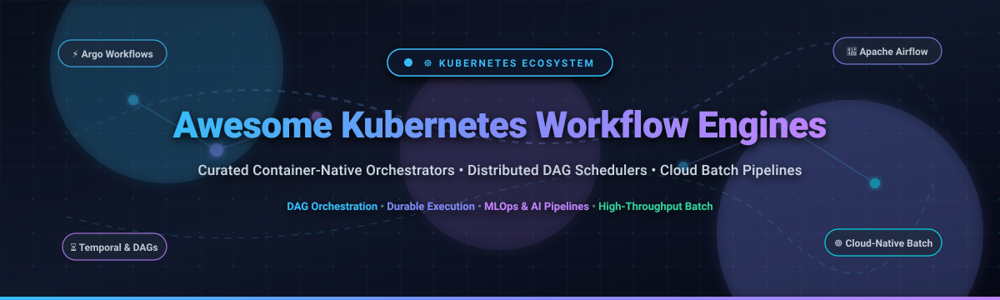
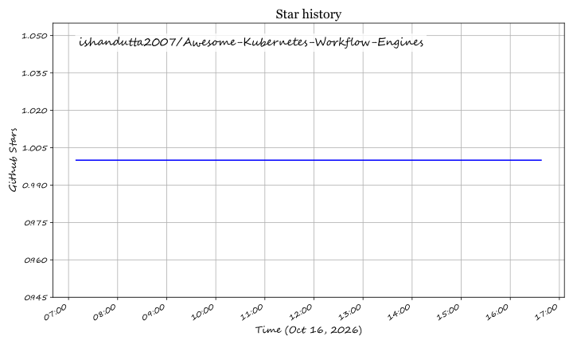

<p align="center">
  
</p>

# Awesome Kubernetes Workflow Engines

<p align="center">
  <a href="https://github.com/ishandutta2007/Awesome-Awesome-Awesome"></a><a href="https://discord.gg/jc4xtF58Ve"></a> <a href="https://github.com/ishandutta2007/Awesome-Awesome-Awesome"></a> <a href="LICENSE"></a> <a href="https://github.com/ishandutta2007/Awesome-Kubernetes-Workflow-Engines/pulls"></a> <a href="https://github.com/ishandutta2007"></a>
</p>

> 🚀 A curated list of awesome **Kubernetes Workflow Engines**, container-native DAG orchestrators, durable execution engines, batch scheduling systems, and distributed task pipelines for cloud-native engineering, MLOps, CI/CD, and data architectures.

📅 **Last updated: March 2026**

Kubernetes workflow engines empower platform engineers, data teams, and ML practitioners to orchestrate complex Directed Acyclic Graphs (DAGs), stateful long-running workflows, high-throughput batch computation, and event-driven automation directly on Kubernetes clusters. By leveraging container sandboxing, elastic horizontal pod autoscaling, and declarative Custom Resource Definitions (CRDs), these orchestrators transform Kubernetes clusters into resilient, enterprise-grade workflow control planes.

---

## 📑 Table of Contents

- [📊 Sector Overview & Market Dynamics](#-sector-overview--market-dynamics)
- [☁️ SaaS & Hosted Platforms](#️-saas--hosted-platforms)
- [⚙️ Open-Source Workflow Engines](#️-open-source-workflow-engines)
- [🏗️ Architectural Patterns & Selection Guide](#️-architectural-patterns--selection-guide)
- [📈 Star History](#--star-history)
- [💖 Support & Community](#-support--community)
- [🤝 How to Contribute](#-how-to-contribute)
- [📜 Disclaimer & License](#-disclaimer--license)

---

## 📊 Sector Overview & Market Dynamics

- 📈 **Market Size & Expansion:** The global cloud workflow orchestration and distributed data pipeline market is valued at approximately **$8.5 billion in 2025** and is projected to surge past **$18.2 billion by 2030**, advancing at a robust compound annual growth rate (**CAGR of ~16.5%**). Key growth drivers include enterprise Kubernetes migration, widespread LLM/Generative AI training and fine-tuning pipelines, and distributed data platform modernization.
- 🧩 **Market Fragmentation & Competitive Dynamics:** The sector exhibits **moderate fragmentation**. Cloud hyperscalers (Microsoft Azure, Google Cloud Platform, and Amazon Web Services) capture significant managed enterprise market share by bundling managed orchestrators with cloud infrastructure. Simultaneously, a dynamic and fiercely competitive layer of open-source-born independent platforms (Argo Workflows, Apache Airflow / Astronomer, Temporal, Prefect, Dagster, and Kestra) commands strong developer loyalty and workload customization, preventing a winner-take-all monopoly.

---

## ☁️ SaaS & Hosted Platforms

The following hosted, managed, and serverless workflow platforms execute or interface directly with Kubernetes clusters. Entries are sorted in **descending order** by company scale (market capitalization or private venture valuation).

| 🏢 Platform | 💰 Company Scale (Valuation / Revenue) | 🏷️ Starting Tier Pricing | 🆓 Free Tier / Trial Limits | ☸️ Key Kubernetes Capabilities |
| :--- | :--- | :--- | :--- | :--- |
| **[Azure Data Factory](https://azure.microsoft.com/en-us/products/data-factory)** | **~$3.1T Market Cap** (~$245B+ Annual Revenue) | **$0.005/hour** pipeline orchestration; **$1.00 per 1,000** activity runs; **$0.25/DIU-hr** execution | **30-day free trial with $200 credit**; ongoing free tier of **5 low-frequency pipeline activities/month** | Cloud-scale ETL/ELT pipeline orchestration with direct Azure Kubernetes Service (AKS) pod execution activities. |
| **[Google Cloud Composer](https://cloud.google.com/composer)** | **~$2.1T Market Cap** (~$307B+ Annual Revenue) | **~$0.045/Composer Unit-hr** (~$25–$35/mo baseline env) + GKE cluster compute consumption | **90-day free trial with $300 credit** across all Google Cloud services | Fully managed Apache Airflow built natively on Google Kubernetes Engine (GKE) with auto-scaling workers and Workload Identity. |
| **[AWS Step Functions](https://aws.amazon.com/step-functions/)** | **~$1.9T Market Cap** (~$575B+ Annual Revenue) | **$0.025 per 1,000 state transitions** (Standard); **$1.00 per 1M requests** + duration (Express) | **Free forever plan: 4,000 state transitions/month** under AWS Free Tier | Visual serverless state machines that directly trigger, coordinate, and track Amazon EKS jobs and container tasks. |
| **[Temporal Cloud](https://temporal.io/cloud)** | **~$1.5B Valuation** ($203M+ venture funding) | **$0.042 per 1,000 Actions** + **$0.0042 per GB-hour** active storage ($0 baseline monthly commitment) | **30-day free trial with $1,000 usage credits** | Fully managed durable execution engine powering fault-tolerant distributed workflows running inside Kubernetes worker fleets. |
| **[Astronomer (Astro)](https://www.astronomer.io/)** | **~$1.0B+ Valuation** ($283M+ venture funding) | **$0.35/hour per Astro Unit (AU)** (Astro Standard tier, starter deployments ~$65/month) | **14-day free trial with $300 in usage credits** | Enterprise managed Apache Airflow with Kubernetes-native deployment executors, CI/CD integrations, and lineage telemetry. |
| **[Dagster Cloud](https://dagster.io/cloud)** | **~$300M+ Valuation** ($58M+ venture funding) | **$10/month** (Starter Serverless) + $0.01 per step execution; **$100/month** (Pro plan) | **Free Serverless plan with 250 credits/month**; **30-day free trial** of Pro with full feature access | Asset-centric data orchestrator with hybrid Kubernetes execution, software-defined assets, and native dbt integrations. |
| **[Prefect Cloud](https://www.prefect.io/)** | **~$250M+ Valuation** ($46.3M venture funding) | **$28/month** (Pro tier base or $39/user/month) + hybrid execution | **Free forever plan: 1 user, 3 workspaces, 10,000 flow runs/month** (or 20,000 compute credits) | Python-native workflow control plane featuring hybrid Kubernetes worker pod orchestration and dynamic DAG dispatching. |

---

## ⚙️ Open-Source Workflow Engines

Below are top open-source workflow orchestrators, schedulers, and pipeline engines that natively deploy on or execute against Kubernetes. Ranked in **descending order** by live GitHub Stars_Count.

1. **[Apache Airflow](https://github.com/apache/airflow)** [](https://github.com/apache/airflow/stargazers)  
   🌪️ The industry-standard batch workflow orchestrator with Python-defined DAGs, 1,000+ ecosystem operators, rich observability UI, and battle-tested Kubernetes executors (`KubernetesExecutor` and `KubernetesPodOperator`).

2. **[Ray + KubeRay](https://github.com/ray-project/ray)** [](https://github.com/ray-project/ray/stargazers)  
   ⚡ Unified compute framework for scaling distributed AI and Python applications. The official KubeRay operator manages elastic Ray clusters on Kubernetes for distributed batch jobs and large-scale data transformations.

3. **[Conductor](https://github.com/conductor-oss/conductor)** [](https://github.com/conductor-oss/conductor/stargazers)  
   🎼 Netflix-originated microservices and workflow orchestration engine. Language-agnostic, event-driven, supports complex JSON/YAML-defined state machines, and deploys natively as Kubernetes services.

4. **[Kestra](https://github.com/kestra-io/kestra)** [](https://github.com/kestra-io/kestra/stargazers)  
   🎨 Modern declarative, language-agnostic workflow orchestrator with intuitive YAML definitions. Features real-time topology visualization, built-in code editor, and container task execution via Kubernetes Pod plugins.

5. **[Prefect](https://github.com/PrefectHQ/prefect)** [](https://github.com/PrefectHQ/prefect/stargazers)  
   🎯 Python-centric workflow orchestration library powered by `@flow` and `@task` decorators. Features dynamic runtime DAGs, automated retries, and modular Kubernetes work pools that spawn pods per run.

6. **[Temporal](https://github.com/temporalio/temporal)** [](https://github.com/temporalio/temporal/stargazers)  
   ⏱️ Open-source durable execution system for resilient microservices and long-running stateful workflows. Manages workflow state, timers, and retry policies while worker code runs inside Kubernetes Pods.

7. **[Argo Workflows](https://github.com/argoproj/argo-workflows)** [](https://github.com/argoproj/argo-workflows/stargazers)  
   🐙 The CNCF graduated, container-native workflow engine for Kubernetes. Each step in a workflow executes directly as a Kubernetes pod; supports parallel DAGs, artifact drivers, dynamic fan-out/fan-in, and GitOps pipelines.

8. **[Dagster](https://github.com/dagster-io/dagster)** [](https://github.com/dagster-io/dagster/stargazers)  
   📦 Data orchestrator designed around software-defined assets rather than simple task graphs. Provides end-to-end data lineage, integrated local development, and the `dagster-k8s` executor for distributed pod scheduling.

9. **[Crossplane](https://github.com/crossplane/crossplane)** [](https://github.com/crossplane/crossplane/stargazers)  
   🌐 CNCF graduated framework that transforms Kubernetes clusters into universal infrastructure control planes, enabling declarative provisioning and orchestration of cloud infrastructure as native Kubernetes resources.

10. **[Metaflow](https://github.com/Netflix/metaflow)** [](https://github.com/Netflix/metaflow/stargazers)  
    🧠 Netflix-developed, human-centric Python framework for data science, ML pipelines, and AI engineering. Integrates natively with Kubernetes to dynamically run compute steps on GPU/CPU pods.

11. **[Cadence](https://github.com/uber/cadence)** [](https://github.com/uber/cadence/stargazers)  
    🛡️ Uber’s open-source durable workflow execution engine (Linux Foundation). Ensures stateful code execution survives process failures and network partitions across containerized Kubernetes clusters.

12. **[Tekton Pipelines](https://github.com/tektoncd/pipeline)** [](https://github.com/tektoncd/pipeline/stargazers)  
    🏗️ Kubernetes-native CI/CD workflow framework governed by the CD Foundation. Standardizes cloud-native continuous integration and deployment using custom `Task`, `Pipeline`, and `PipelineRun` CRDs.

13. **[Flyte](https://github.com/flyteorg/flyte)** [](https://github.com/flyteorg/flyte/stargazers)  
    🪁 Linux Foundation AI & Data hosted Kubernetes-native workflow orchestrator for machine learning and data processing with strongly typed Python interfaces, container versioning, and caching.

14. **[Volcano](https://github.com/volcano-sh/volcano)** [](https://github.com/volcano-sh/volcano/stargazers)  
    🌋 CNCF batch scheduling and workflow engine tailored for high-performance computing (HPC), AI/ML, and big data workloads on Kubernetes with gang scheduling, fair-share queueing, and topology awareness.

15. **[Kubeflow Pipelines](https://github.com/kubeflow/pipelines)** [](https://github.com/kubeflow/pipelines/stargazers)  
    🧪 Dedicated ML pipeline orchestrator within the Kubeflow project. Compiles Python DSL definitions into Intermediate Representation (IR) graphs executed directly on Kubernetes clusters.

16. **[Nextflow](https://github.com/nextflow-io/nextflow)** [](https://github.com/nextflow-io/nextflow/stargazers)  
    🧬 Data-driven computational workflow framework heavily utilized in genomics and biomedical research. Features a native Kubernetes executor that automatically submits tasks as containerized pods.

17. **[Kueue](https://github.com/kubernetes-sigs/kueue)** [](https://github.com/kubernetes-sigs/kueue/stargazers)  
    🚦 Kubernetes SIGs project providing job queueing, resource quota management, and multi-tenant fair sharing for Kubernetes batch jobs, MPIJobs, RayJobs, and workflow engine pods.

18. **[Snakemake](https://github.com/snakemake/snakemake)** [](https://github.com/snakemake/snakemake/stargazers)  
    🐍 Python-based workflow management engine focused on reproducibility, transparency, and data analysis pipelines with seamless out-of-the-box Kubernetes cluster execution.

19. **[Cromwell](https://github.com/broadinstitute/cromwell)** [](https://github.com/broadinstitute/cromwell/stargazers)  
    🔬 Scientific workflow engine developed by the Broad Institute supporting Workflow Description Language (WDL) and CWL, featuring a backend provider for Kubernetes batch execution.

20. **[Furiko](https://github.com/furiko-io/furiko)** [](https://github.com/furiko-io/furiko/stargazers)  
    ⏰ Enterprise-ready cron scheduling and ad-hoc job execution platform for Kubernetes with robust concurrency policies, timezone-aware scheduling, retry policies, and execution history.

21. **[Kit](https://github.com/kitproj/kit)** [](https://github.com/kitproj/kit/stargazers)  
    🧰 Unified workflow engine that binds together task execution, local process monitoring, service orchestration, and Kubernetes resource management into developer workflows.

22. **[Kontroler](https://github.com/GreedyKomodoDragon/Kontroler)** [](https://github.com/GreedyKomodoDragon/Kontroler/stargazers)  
    🦎 Lightweight, Kubernetes-native DAG orchestrator supporting declarative YAML specifications and code-based pipeline construction for low-overhead container task chaining.

23. **[FUSE](https://github.com/open-source-cloud/fuse)** [](https://github.com/open-source-cloud/fuse/stargazers)  
    💡 Actor-based workflow engine designed for AI agent workflows and durable stateful orchestration with event-driven execution models.

---

## 🏗️ Architectural Patterns & Selection Guide

When selecting a Kubernetes workflow orchestrator, match your application requirements to the appropriate paradigm:

```
+-----------------------------------------------------------------------------------------+
|                               KUBERNETES WORKFLOW PARADIGMS                             |
+-----------------------------------------------------------------------------------------+
|  1. Run-to-Completion DAGs       |  Argo Workflows, Tekton, Flyte, Kubeflow Pipelines   |
|     (Container-native execution) |  Best for: Batch processing, MLOps, CI/CD, ETL       |
+----------------------------------+------------------------------------------------------+
|  2. Durable Execution Engines    |  Temporal, Cadence, AWS Step Functions               |
|     (Code-as-workflows, stateful)|  Best for: Microservice sagas, payment/order flows   |
+----------------------------------+------------------------------------------------------+
|  3. Asset-Centric Orchestrators  |  Dagster, Apache Airflow, Kestra                     |
|     (Data lineage & dependencies)|  Best for: Data warehouses, dbt, analytics pipelines|
+----------------------------------+------------------------------------------------------+
|  4. Batch Queue & Resource Mgrs  |  Volcano, Kueue, Ray / KubeRay                       |
|     (HPC, gang scheduling)       |  Best for: Distributed AI training, multi-tenant GPUs|
+-----------------------------------------------------------------------------------------+
```

---

##  Star History

[](https://star-history.dera.page/#ishandutta2007/Awesome-Kubernetes-Workflow-Engines&type=date&legend=top-left)

---

## 💖 Support & Community

Thank you for exploring and using **Awesome Kubernetes Workflow Engines**! If this curated collection helps you design, evaluate, or operate cloud-native workflow platforms:

- ⭐ **Star this repository** to help others discover it.
- 🍴 **Fork the project** and contribute entries or improvements.
- 📢 **Share with your network** — platform engineers, SREs, and data teams.
- ☕ **Support the maintainer:** If you find this valuable, consider sponsoring or buying a coffee via the [GitHub Sponsors Dashboard](https://github.com/sponsors/ishandutta2007).

[](https://github.com/sponsors/ishandutta2007)

---

## 🤝 How to Contribute

Contributions are warmly encouraged! To propose a new workflow engine or update existing entries:

1. **Fork the Repository** to your GitHub account.
2. **Add or Edit Entries** in [README.md](README.md), adhering to alphabetical or star-based sorting and tabular structure.
3. **Include Key Data**: Name, official link, Stars_Badge, accurate pricing/free-tier details, and concise factual description.
4. **Submit a Pull Request** with a brief summary of additions or revisions.

---

## 📜 Disclaimer & License

- 🛡️ This repository is a **community-curated index** provided for educational and platform comparison purposes.
- 🔒 Workflow systems operate with infrastructure-level privileges; always implement zero-trust RBAC, secret encryption, and audit logging before deploying to production clusters.
- ⚖️ Distributed under the [MIT License](LICENSE).

## Star History

<a href="https://star-history.com/#ishandutta2007/Awesome-Kubernetes-Workflow-Engines&Timeline" align="center">
  <picture>
    <source media="(prefers-color-scheme: dark)" srcset="assets/ishandutta2007_Awesome-Kubernetes-Workflow-Engines_growth.svg">
    
  </picture>
</a>
